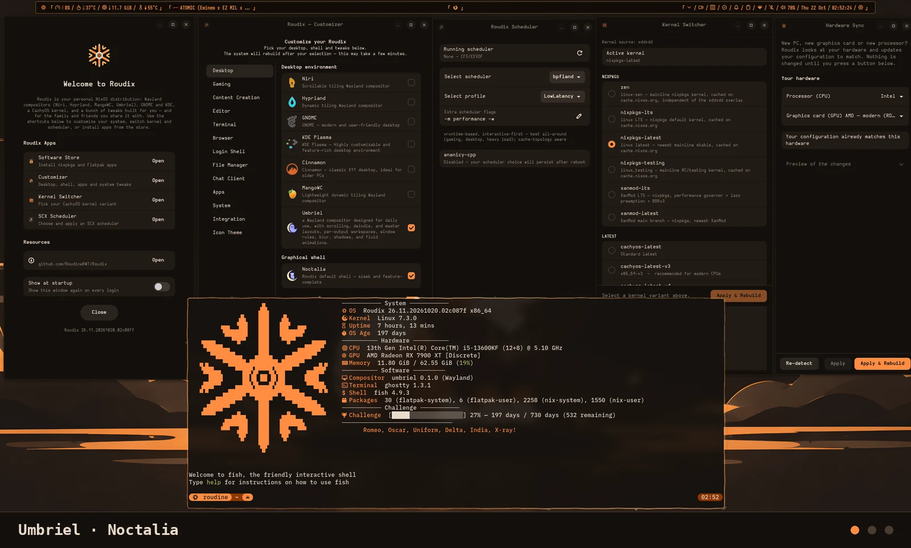

[English](README.md) · [Français](README.fr.md) · [Español](README.es.md) · [Português (Brasil)](README.pt_BR.md) · [Русский](README.ru.md) · [简体中文](README.zh_CN.md) · [हिन्दी](README.hi.md) · **العربية**

<div align="center">


# Roudix
### إعدادات NixOS (Unstable) — عدة مُركِّبات Wayland (hyprland وniri وmangowc وumbriel) · Gnome وKDE · نواة CachyOS


<br/>

| معاينة |
|:---:|
|  |

<sub>تخصيص شخصي — سيبدو إعدادك مختلفًا بحسب تهيئتك 👀</sub><br/>
<sub>مُركِّبات Wayland متروكة لك لتخصيصها: يوفّر Roudix فقط الإعدادات الافتراضية لـ Noctalia وDankMaterialShell و(لـ Hyprland فقط) Caelestia.</sub>

</div>

---

## العتاد

| المكوّن | الطراز |
|-----------|-------|
| CPU | Intel Core i5-13600KF |
| GPU | AMD Radeon RX 7900 XT |

---

## المكدّس

| الطبقة | الاختيار |
|-------|--------|
| نظام التشغيل | Roudix (NixOS unstable) |
| Kernel | CachyOS (اختر نسخة النواة من [الميزات](docs/features.md) أو [التثبيت](docs/installation.ar.md)) |
| Bootloader | Limine (افتراضي) · systemd-boot |
| Compositor | Niri (تبليط قابل للتمرير) · Hyprland (تبليط ديناميكي) · MangoWC · Umbriel (تبليط قابل للتمرير، أصلي في Noctalia) |
| الواجهة الرسومية (shell) | Noctalia · DankMaterialShell · Caelestia |
| بيئة سطح المكتب | KDE Plasma · Gnome |
| مدير تسجيل الدخول | DMS Greeter (Dms فقط) · Noctalia Greeter (noctalia فقط) · plasma-login-manager (KDE فقط) · GDM (Gnome فقط) |
| الطرفية | قابل للضبط (Ghossty, Kitty, Foot, Wzertem, Konsole, Ptyxis) |
| الصدفة (Shell) | Fish · Bash |
| المتصفح | قابل للضبط (Brave, Helium, Vivaldi, Firefox, LibreWolf, Chromium, Zen Twilight) |
| مدير الملفات | قابل للضبط (Nautilus, Thunar, Dolphin, Nemo) |
| المحرر | قابل للضبط (Zed, VS Code, Neovim، بدون) |
| الدردشة | Discord (Vencord · vanilla · بدون) + Matrix (Element · Cinny · بدون) |
| الموسيقى | قابل للضبط (Spotify + Spicetify, YouTube Music Desktop، بدون) |

---

## التوثيق

| | |
|-|-|
| 🖥️ [سطح المكتب والواجهات](docs/desktop.md) | تبديل المُركِّبات والواجهات الرسومية، والتخصيصات الشخصية (Niri, Hyprland, GNOME, KDE) |
| ⚡ [الأسماء المستعارة والدوال](docs/aliases.ar.md) | جميع الأسماء المستعارة والدوال في الصدفة — `roudix-switch`, `roudix-shell-switch`, `rebuild`… |
| 🚀 [التثبيت](docs/installation.ar.md) | دليل التثبيت التلقائي واليدوي |
| ✨ [الميزات](docs/features.md) | قائمة الميزات الكاملة حسب بيئة سطح المكتب |
| 🔄 [التحديث التلقائي](docs/autoupdate.ar.md) | إعداد git pull + إعادة البناء التلقائيين |

---

## البنية

```
roudix/
├── roudix-installer.sh              # مثبّت مبني على Bash
├── flake.nix                        # المدخلات والمخرجات
├── flake.lock
├── docs/                            # التوثيق
│   ├── desktop.md                   # بيئات سطح المكتب والواجهات الرسومية
│   ├── aliases.md                   # الأسماء المستعارة والدوال في الصدفة
│   ├── installation.md              # دليل التثبيت
│   ├── features.md                  # قائمة الميزات
│   ├── features.fr.md               # قائمة الميزات (بالفرنسية)
│   └── autoupdate.md                # إعداد التحديث التلقائي
│
├── hosts/
│   └── roudix/                      # مضيف واحد — تُختار بيئة سطح المكتب عبر roudix.desktop.type
│       ├── configuration.nix
│       ├── username.nix             # في gitignore — اسم المستخدم الخاص بك (انظر التثبيت)
│       ├── local.nix                # في gitignore — تخصيصات نظامك الشخصية
│       ├── local.nix.example        # انسخه إلى local.nix للبدء
│       └── hardware-configuration.nix
│
├── dotfiles/                        # ملفات إعدادات خام يديرها Home Manager
│   ├── easyeffects/                 # إعدادات EasyEffects المسبقة
│   ├── fastfetch/
│   │   └── roudix.txt               # شعار Roudix الافتراضي بصيغة ASCII لـ fastfetch
│   # حُذف niri/ وniri-dms/ — أصبحت إعدادات niri الآن
│   # أصلية بالكامل في Nix (انظر modules/home/desktop/niri/ أدناه).
│   ├── hyprland/                    # إعدادات Hyprland (Lua) — شجرة واحدة لكل واجهة رسومية
│   │   ├── hyprland.lua             # نقطة الدخول: تحمّل وحدات config/
│   │   └── config/
│   │       ├── shell.lua            # تختار الواجهة (noctalia / dms / caelestia) من ROUDIX_HYPR_SHELL
│   │       ├── shells/              # اختصارات وتكامل لكل واجهة (noctalia.lua وdms.lua وcaelestia.lua)
│   │       ├── binds/common.lua     # اختصارات مشتركة بين كل الواجهات
│   │       ├── rules/               # قواعد النوافذ (common.lua وapps.lua وgaming.lua)
│   │       ├── ws.lua               # جدول مساحات العمل المشترك (تستخدمه workspaces وbinds وrules)
│   │       ├── workspaces.lua       # قواعد مساحات العمل
│   │       ├── monitors.lua / input.lua / layout.lua / decorations.lua / animations.lua
│   │       ├── defaults.lua / colors.lua / environment.lua / autostart.lua / misc.lua
│   │       └── nix-noctalia.lua     # تحمّل سمة Noctalia الحية (تولّدها matugen)
│   │   # يولّد Nix الملفين config/nix-plugins.lua وconfig/nix-apps.lua (وهما غير موجودين في المستودع)
│   └── perso/                       # إعدادات شخصية (في gitignore)
│
├── pkgs/
│   ├── roudix-branding              # حزمة هوية Roudix البصرية
│   ├── roudix-kernel-switcher       # حزمة واجهة Roudix Kernel Switcher الرسومية
│   ├── roudix-switcher/             # واجهة إعدادات Roudix الرسومية (سطح المكتب، الألعاب، المحرر، الطرفية، المتصفح، الواجهة، مدير الملفات، الدردشة، النظام، التكامل)
│   └──   roudix-scheduler-switcher    # حزمة واجهة Scheduler Switcher الرسومية
│
└── modules/
    ├── system/                      # وحدات NixOS على مستوى النظام
    │   ├── desktop/                 # وحدات بيئة سطح المكتب (على مستوى NixOS)
    │   │   ├── default.nix          # خيارات سطح المكتب (roudix.desktop.type + roudix.desktop.shell)
    │   │   └── niri.nix / hyprland.nix / gnome.nix / kde.nix / mangowc.nix / umbriel.nix
    │   │
    │   ├── boot/                    # مدير الإقلاع والنواة والمعالج
    │   │   ├── boot.nix             # Limine/systemd-boot + مدخلات أنظمة متعددة
    │   │   ├── boot.local.nix       # في gitignore — مدخلات الإقلاع الشخصية الخاصة بك
    │   │   ├── boot.local.nix.example
    │   │   ├── kernel.nix           # اختيار نسخة النواة — نسخ CachyOS + نواة nixpkgs العادية
    │   │   ├── cpu.nix              # ميكروكود Intel/AMD + وحدات i2c
    │   │   └── bootloader/          # ملف خلفية Limine
    │   │
    │   ├── apps/                    # وحدات اختيار التطبيقات (خيار roudix.* واحد لكل منها)
    │   │   ├── apps.nix / appimage.nix / flatpak.nix / browser.nix / discord.nix
    │   │   ├── telegram.nix / matrix.nix / mail-client.nix / music-player.nix
    │   │   ├── video-player.nix / torrent-client.nix / password-manager.nix
    │   │   └── filemanager.nix / editor.nix / terminal.nix / spicetify.nix / content-creation.nix
    │   │
    │   ├── virtualization/          # QEMU/KVM والحاويات وتعديلات الضيف في الآلات الافتراضية وWaydroid
    │   │   └── virtualization.nix / containers.nix / vm-guest.nix / waydroid.nix
    │   │
    │   ├── rgb/                     # توجيه وحدة التحكم RGB
    │   │   ├── default.nix          # الخيار roudix.rgb (openlinkhub / openrgb / none)
    │   │   └── openlinkhub.nix / openrgb.nix
    │   │
    │   ├── gaming/                  # Steam وGamescope وananicy-cpp وtuned-adm ومجدولات SCX
    │   │   └── gaming.nix / scx.nix
    │   │
    │   ├── gpu/                     # إعدادات GPU (AMD/NVIDIA/Intel/VM + mesa-git)
    │   │
    │   ├── autoupdate.nix       # git pull تلقائي + إعادة بناء عند تغيّر الإعدادات
    │   ├── binary-caches.nix    # ذاكرات Nix الثنائية المؤقتة (substituters + المفاتيح الموثوقة)
    │   ├── common.nix           # إعدادات النظام المشتركة (كل المضيفين)
    │   ├── desktop-integration.nix  # سلسلة المفاتيح + حزمة xdg-desktop-portal للمُركِّبات المجرّدة
    │   ├── environment.nix      # متغيرات البيئة
    │   ├── fstrim.nix           # fstrim لأقراص SSD/NVMe
    │   ├── hosts-gta.nix        # حظر مضيفات BattlEye (إصلاح GTA، اختياري)
    │   ├── icon-theme.nix       # اختيار سمة الأيقونات على مستوى النظام
    │   ├── keyboard.nix         # تخطيط/متغيّر لوحة المفاتيح الرسومية (Wayland)
    │   ├── pipewire.nix         # صوت PipeWire + كتم الضوضاء بـ rnnoise
    │   ├── shell.nix            # الصدفة الافتراضية (fish/bash)
    │   ├── update.nix           # إعدادات تحديث flake
    │   ├── roudix-update.nix    # الأمر `update` (pull + إعادة بناء + Flatpak)، السكربت في roudix-update.sh، وإكمالات الصدفة في completions/
    │   └── version.nix          # الهوية البصرية لنظام Roudix (os-release وdistroName)
    │   # الطرفية/مدير الملفات: اختر المفضّل لديك عبر local.nix في hosts/roudix/
    │
    └── home/                        # وحدات Home Manager على مستوى المستخدم
        ├── common.nix               # إعدادات home المشتركة (كل المستخدمين وبيئات سطح المكتب)
        ├── bash.nix                 # إعدادات صدفة Bash + roudix-switch + roudix-shell-switch
        ├── fastfetch.nix            # Fastfetch + تشغيل تلقائي في fish
        ├── fish.nix                 # صدفة Fish + الأسماء المستعارة + roudix-switch + roudix-shell-switch
        ├── gaming-home.nix          # حزم ألعاب المستخدم (proton وmangohud...)
        ├── git.nix                  # إعدادات Git
        ├── mangohud.nix             # طبقة MangoHud (مشتركة بين بيئات سطح المكتب)
        ├── papirus-icon.nix         # سمة أيقونات Papirus (مشتركة بين بيئات سطح المكتب)
        ├── papirus-folders.nix      # إعداد لون مجلدات Papirus (مشترك)
        ├── tela-icon.nix            # سمة أيقونات Tela (مشتركة بين بيئات سطح المكتب)
        ├── spicetify.nix            # Spotify + Spicetify (سمة Comfy)
        ├── ssh.nix                  # SSH + GitHub
        ├── shell-modules.nix        # استيرادات وحدات الواجهات المشتركة (noctalia وdms وcaelestia)
        └── desktop/                 # مجلد لكل بيئة سطح مكتب — جانب Home Manager، يعكس modules/system/desktop/
            ├── default.nix          # يستورد الستة دون شروط (كل منها محمي داخليًا بـ lib.mkIf)
            ├── gnome/
            │   ├── default.nix      # الخلفية والسمة والأيقونات والمؤشر
            │   └── _extensions.nix  # إضافات GNOME — الحزم وUUID المفعّلة وإعدادات dconf
            ├── kde/default.nix      # إعدادات plasma-manager (الخلفية واللوحات وشاشة القفل)
            ├── hyprland/default.nix # تراعي الواجهة (noctalia/dms/caelestia)، الإضافات، الحزم
            ├── mangowc/default.nix  # ملفا mango config.conf/apps.conf المولَّدان، الحزم
            ├── niri/                # programs.niri.settings، مقسّمة حسب الموضوع، تراعي الواجهة
            │   ├── default.nix      # يجمّع الإعدادات، include السمة الحية، الحزم
            │   ├── _general.nix     # البيئة، التشغيل التلقائي، المؤشر (تراعي الواجهة)
            │   ├── _animation.nix
            │   ├── _input.nix
            │   ├── _layout.nix
            │   ├── _output.nix      # المخارج + مساحات العمل المسمّاة
            │   ├── _ws.nix          # ثوابت رموز أيقونات مساحات العمل المشتركة
            │   ├── _rules-common.nix
            │   ├── _rules-noctalia.nix / _rules-dms.nix
            │   ├── _binds-noctalia.nix / _binds-dms.nix
            │   └── _include-noctalia.nix / _include-dms.nix  # يضيف `include` السمة الحية إلى إعدادات niri-flake المولَّدة
            └── umbriel/             # programs.umbriel.settings، مقسّمة حسب الموضوع (لـ Noctalia فقط)
                ├── default.nix
                ├── _general.nix / _appearance.nix / _animation.nix / _input.nix
                ├── _layout.nix / _output.nix / _binds.nix / _rules.nix
                └── _include-noctalia.nix  # يحمّل noctalia.toml (include السمة الحية الأصلي في Umbriel)
```

---

## مدخلات flake

| المدخل | المصدر |
|-------|--------|
| nixpkgs | [nixos-unstable](https://github.com/NixOS/nixpkgs/tree/nixos-unstable) |
| nixpkgs-stable | [nixos-26.05](https://github.com/NixOS/nixpkgs/tree/nixos-26.05) |
| niri | [epireyn/niri-flake](https://github.com/epireyn/niri-flake) |
| home-manager | [nix-community/home-manager](https://github.com/nix-community/home-manager) |
| noctalia | [noctalia-dev/noctalia](https://github.com/noctalia-dev/noctalia) |
| umbriel | [noctalia-dev/umbriel](https://github.com/noctalia-dev/umbriel) |
| caelestia-shell | [caelestia-dots/shell](https://github.com/caelestia-dots/shell) |
| dms | [AvengeMedia/DankMaterialShell](https://github.com/AvengeMedia/DankMaterialShell) |
| nix-cachyos-kernel | [xddxdd/nix-cachyos-kernel](https://github.com/xddxdd/nix-cachyos-kernel) |
| chaotic | [chaotic-cx/nyx](https://github.com/chaotic-cx/nyx) |
| zen-browser | [0xc000022070/zen-browser-flake](https://github.com/0xc000022070/zen-browser-flake) |
| spicetify-nix | [Gerg-L/spicetify-nix](https://github.com/Gerg-L/spicetify-nix) |
| millennium | [SteamClientHomebrew/Millennium](https://github.com/SteamClientHomebrew/Millennium) |
| helium | [x13-me/helium-nix](https://github.com/x13-me/helium-nix) |
| nix-flatpak | [gmodena/nix-flatpak](https://github.com/gmodena/nix-flatpak) |
| plasma-manager | [nix-community/plasma-manager](https://github.com/nix-community/plasma-manager) |
| brave-previews | [roudinebwt/brave-preview](https://github.com/roudinebwt/brave-preview) |
| roudix-caches | [RoudineBWT/Roudix-caches](https://github.com/RoudineBWT/Roudix-caches) |
| nix-gaming-edge | [powerofthe69/nix-gaming-edge](https://github.com/powerofthe69/nix-gaming-edge) |
| betterbird-nix | [TheAnachronism/betterbird-nix](https://github.com/TheAnachronism/betterbird-nix) |
---

## انظر أيضًا

| المشروع | الوصف |
|---------|-------------|
| [GLF OS](https://framagit.org/gaming-linux-fr/glf-os/glf-os) | توزيعة ألعاب مبنية على NixOS من Gaming Linux FR |

---

## ملفات dotfiles الشخصية

توجد ملفات الإعدادات الشخصية في `dotfiles/perso/` — وهي مُدرجة في gitignore (باستثناء `dotfiles/perso/README.md`) ولا يمسّها `git pull` ولا المحدِّث التلقائي أبدًا.

راجع [`dotfiles/perso/README.md`](dotfiles/perso/README.md) للبنية وطريقة الاستخدام.

للتخصيصات على مستوى المُركِّب (الشاشات، الاختصارات، المسافات…)، استخدم بدلًا من ذلك ملفات التخصيص المولَّدة للمستخدم — يديرها home-manager وهي بمنأى عن `git pull`. راجع [سطح المكتب والواجهات](docs/desktop.md#personal-compositor-overrides) لمزيد من التفاصيل.

## التطوير

```bash
nix develop     # بيئة التطوير: just وruff وstatix وdeadnix وshellcheck وgettext
just            # يعرض المهام
just ci         # كل ما تفحصه CI (تقييم كل مضيف، lint، Python، الترجمات)
```

تُترجم الواجهة المثبّتة عبر gettext — راجع [المثبّت › الترجمات](iso/roudix-installer/README.md#traductions).

## الترخيص
   MIT — راجع [LICENSE](LICENSE). متجر Roudix Store مرخّص بـ GPL-2.0-only وتحتفظ بعض
   ملفات الجهات الخارجية بتراخيصها الخاصة: راجع [THIRD_PARTY.md](THIRD_PARTY.md).
